  

  Electronics-ICT student at <b>UHasselt</b>. 

### what i work with

### activity

<picture>
  <source media="(prefers-color-scheme: dark)" srcset="https://streak-stats.demolab.com?user=Empel06&theme=dark&hide_border=true&background=0D1117" />
  
</picture>

